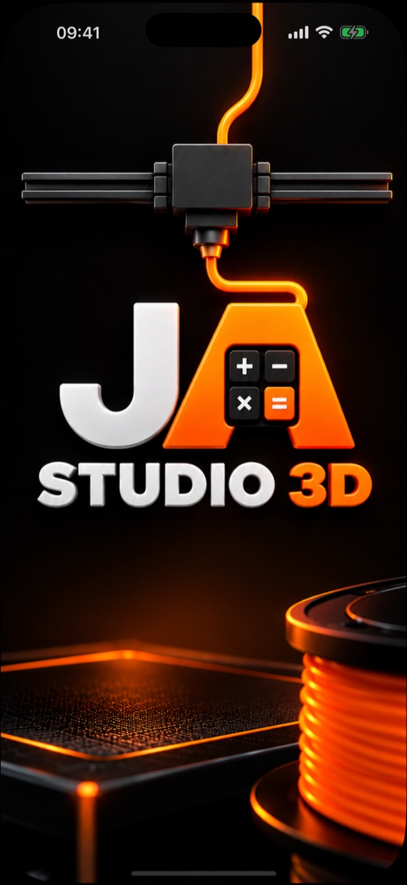
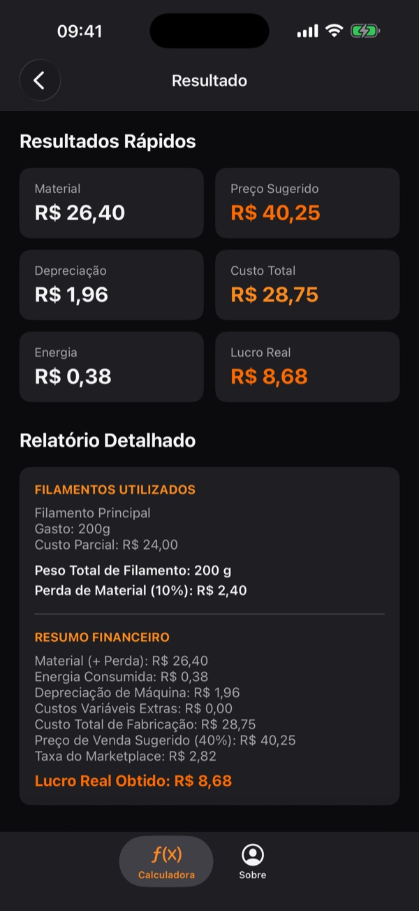
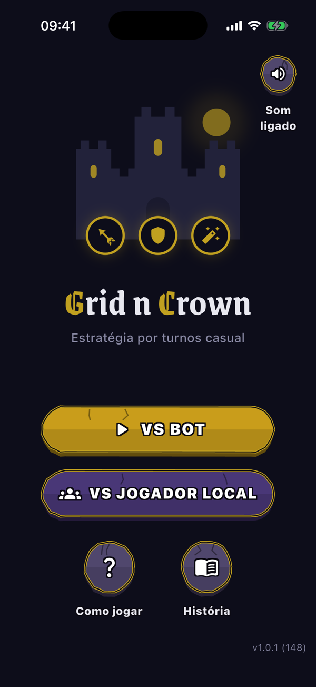
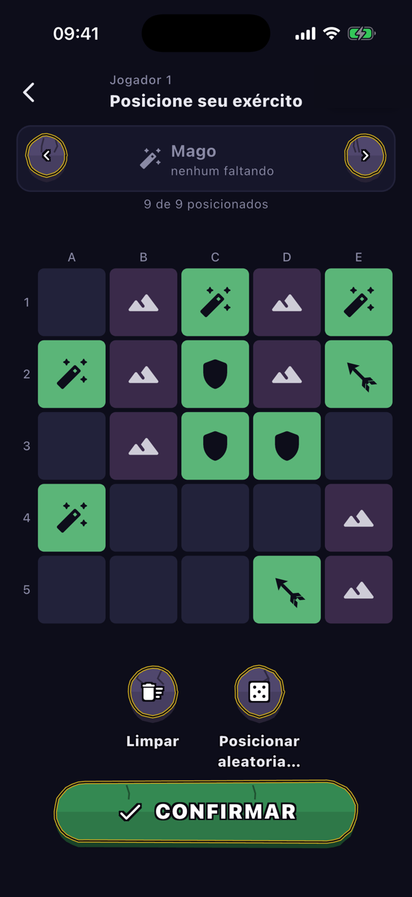

# Olá, eu sou o Romulo Motta 👋

**Desenvolvedor Mobile & Backend.** Gosto de levar uma ideia do rascunho até a loja,
cuidando do código, dos testes e do produto.

**Formação:** Análise e Desenvolvimento de Sistemas · MBA em Desenvolvimento Full Stack

---

## Alguns projetos

> O código desses projetos é privado. Aqui vai uma amostra do que eles fazem.

### 🧮 JA Studio 3D (iOS)

Calculadora de custo e preço de venda de peças impressas em 3D: filamento e perda,
energia, depreciação da máquina, margem de lucro e taxa do marketplace.
Funciona sem internet e não pede cadastro.

- **Swift + UIKit** com Coordinators, layout em código, tema claro e escuro, Dynamic Type e VoiceOver
- Conteúdo da aba Sobre atualizado pelo GitHub Pages, sem precisar publicar o app de novo
- Mais de 200 testes automatizados; já está no TestFlight
- 🌐 [Página do app](https://romulomotta.github.io/jastudioinfo/)

  
  &nbsp;&nbsp;
  

### 👑 Grid n Crown (Flutter)

Jogo de estratégia por turnos inspirado na Batalha Naval: três reinos, classes com
padrões de ataque diferentes, terrenos que ferem quem ataca e a intervenção do Rei,
uma vez por partida. Dá para jogar com duas pessoas no mesmo celular ou contra o Bot.

- **Flutter + Riverpod**, iOS e Android, em português e inglês
- Motor do jogo em Dart puro, separado da interface, pensado para um dia rodar no servidor (multiplayer)
- Design próprio: paleta, botões de pedra e textos com contraste conferido (WCAG)

  
  &nbsp;&nbsp;
  

---

## Outros trabalhos

- [Planilha Financeira](https://planilha-financeira.netlify.app/): versão web da Planilha de Investimentos do Investidor Sardinha (em andamento)
- [Landing page da psicóloga Ana Mendonça](https://anamendoncapsi.netlify.app/)

## Contato

